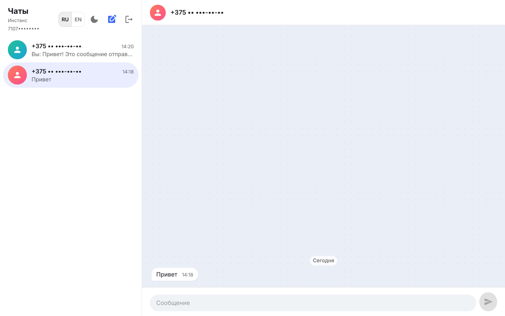
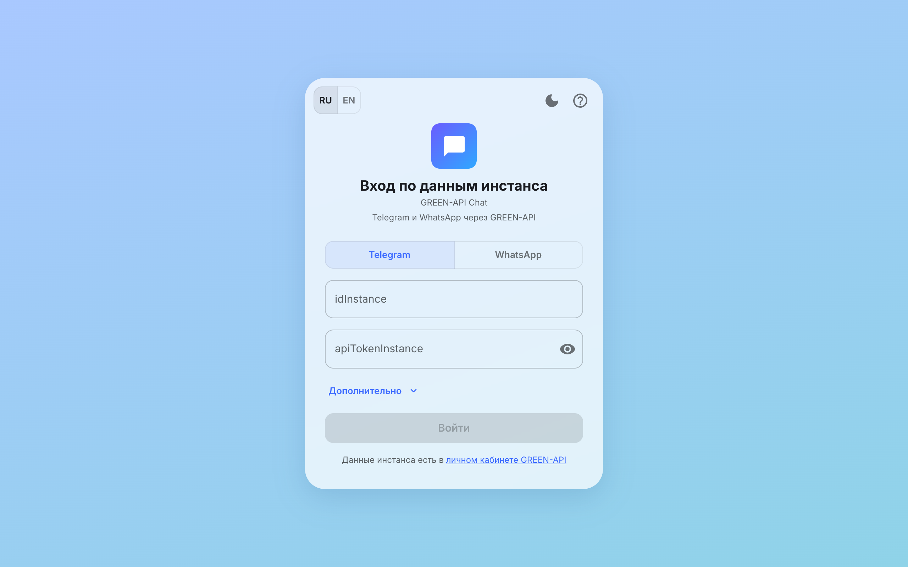
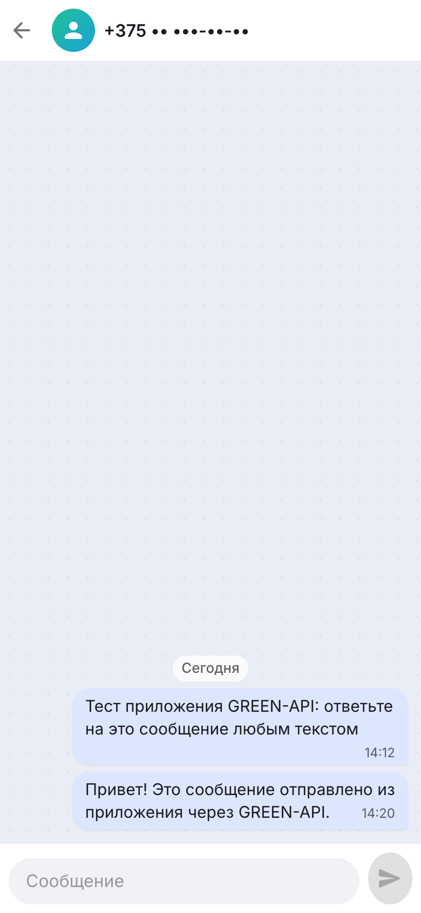
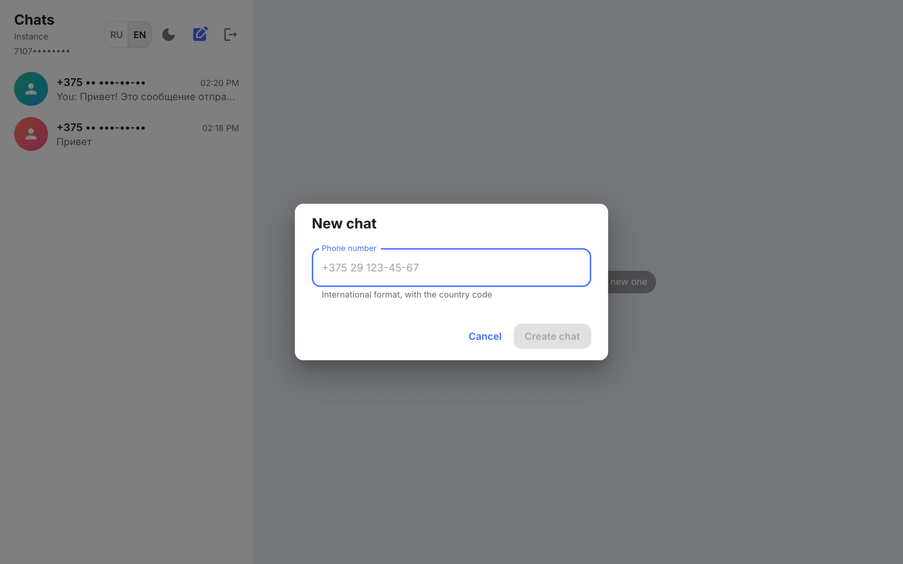
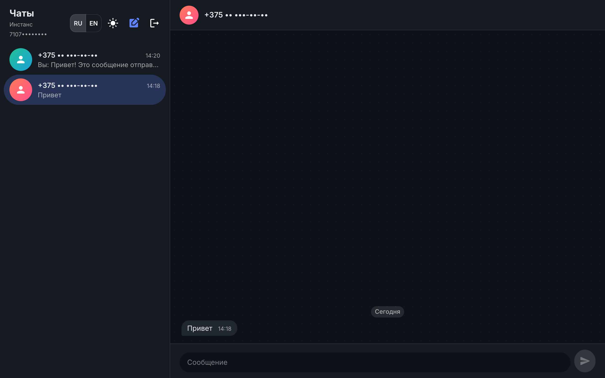
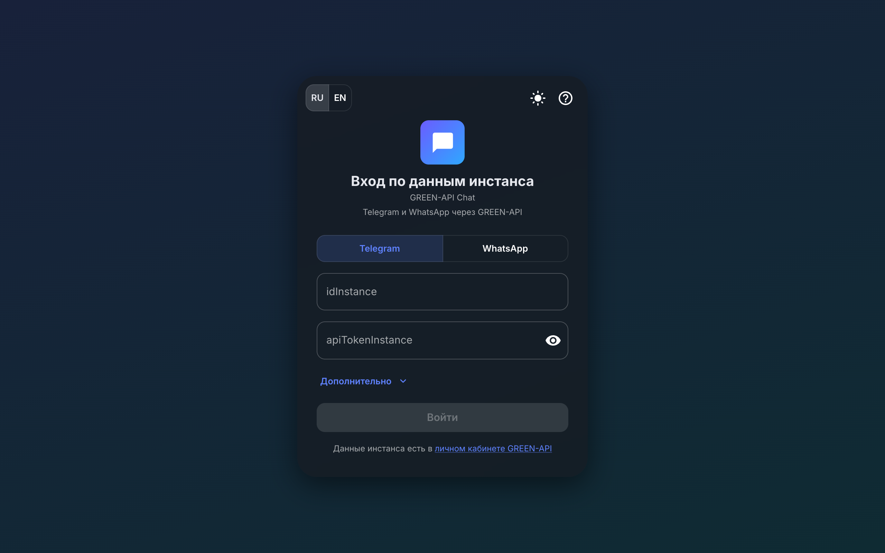

# GREEN-API Chat

Веб-чат для отправки и получения текстовых сообщений в Telegram и WhatsApp через [GREEN-API](https://green-api.com/). Тестовое задание на позицию «Фронтенд разработчик React». Внешний вид сделан по мотивам [web.max.ru](https://web.max.ru/).

**Онлайн-версия:** https://green-apitesttask-lac.vercel.app/



## Скриншоты

Скриншоты сняты на живом WhatsApp-инстансе GREEN-API (реальные запросы, без подмены ответов). Номера телефонов и `idInstance` скрыты.

| Вход                                   |
| -------------------------------------- |
|     |

| Мобильная версия: список чатов                   | Мобильная версия: чат                            | Новый чат (EN)                                    |
| ------------------------------------------------ | ------------------------------------------------ | ------------------------------------------------- |
|       |          |     |

| Тёмная тема: чат                         | Тёмная тема: вход                          |
| ---------------------------------------- | ------------------------------------------ |
|    |    |

## Что умеет

1. Вход по `idInstance` и `apiTokenInstance` из личного кабинета GREEN-API. Опечатки ловятся сразу под полем (`idInstance` — только цифры, `apiUrl` — адрес `https://…`), а верность данных проверяет сервер. Перед входом проверяется, что данные верные и к инстансу привязан аккаунт мессенджера (`getStateInstance`). Мессенджер выбирается на экране входа: Telegram (по умолчанию) или WhatsApp.
2. Новый чат по номеру телефона в любом формате (`+375 (29) 123-45-67`). В Telegram можно ещё и по `@username`. Telegram: номер переводится в `chatId` методом `checkAccount`. WhatsApp: номер проверяется методом `checkWhatsapp`, а чат адресуется как `номер@c.us`.
3. Отправка текстовых сообщений — `sendMessage`.
4. Получение сообщений через HTTP API — `receiveNotification` + `deleteNotification`. Если человек написал первым, чат появится сам.
5. История чата подтягивается при открытии (`getChatHistory`), пока она грузится — показывается скелетон.
6. Переписка и вход сохраняются в `localStorage` и не пропадают после перезагрузки страницы.
7. Русский и английский интерфейс с переключателем.
8. Адаптивная вёрстка: на телефоне показывается либо список чатов, либо открытый чат.
9. Разделители по дням в переписке; чат не прокручивается вниз, пока вы читаете историю.
10. Плашка «Нет связи», если не удаётся получить сообщения; она исчезает, как только связь восстановилась.
11. Светлая и тёмная тема: по умолчанию как в системе, выбор сохраняется. Режим темы хранится в Zustand (`useAppStore`), цвета чата лежат в палитре темы MUI.
12. Два мессенджера: Telegram и WhatsApp выбираются на входе. Остальное (отправка, приём, история) у них общее. WhatsApp проверен на живом инстансе: вход, проверка номера, отправка и приём. Telegram реализован по документации GREEN-API, на живом инстансе пока не проверялся.

## Стек

- React 19 + TypeScript + Vite
- MUI: тема в `src/theme.ts`, стили компонентов через `sx` и компоненты `Stack`/`Typography`, без отдельных CSS-файлов
- Zustand
- Axios
- Vitest + Testing Library

## Структура

```
src/
├── api/            client.ts — axios, greenApi.ts — методы GREEN-API
├── components/     компонент = папка: Component.tsx, *Data.ts (данные для компонента)
│   ├── LoginPage/
│   ├── ChatPage/        раскладка: список чатов + открытый чат
│   ├── Sidebar/         список чатов, ChatListItem/
│   ├── ChatWindow/      ChatHeader/, MessageList/, MessageBubble/, MessageSkeleton/, MessageInput/
│   ├── NewChatDialog/
│   ├── ChatAvatar/  EmptyChat/  LanguageSwitch/  AppTheme/
├── hooks/          useLogin, useCreateChat, useSendMessage, useChatHistory, useNotifications, useTranslation
├── store/          useAuthStore, useChatStore, useAppStore (язык)
├── lib/            чистые функции: разбор уведомлений, истории, номера телефона и т.д.
├── i18n/           ru.ts, en.ts
├── theme.ts        тема MUI и цвета чата
├── test/           настройка тестов и общие тестовые данные
└── types.ts
```

Компоненты отвечают только за отображение, запросы и логика — в хуках, работа с сетью — в `api/`, преобразование данных — в `lib/`.

## Как устроено получение сообщений

GREEN-API складывает входящие события в очередь. Хук `useNotifications` в цикле:

1. вызывает `receiveNotification` — сервер держит запрос до 20 секунд, пока не появится событие (long polling);
2. если это текстовое сообщение (`incomingMessageReceived`, или `outgoingMessageReceived`, если написали с телефона) — добавляет его в нужный чат;
3. вызывает `deleteNotification`, чтобы убрать событие из очереди, и переходит к следующему.

При выходе из аккаунта текущий запрос обрывается через `AbortController`. Сообщения проверяются по `idMessage`, поэтому повторно пришедшее уведомление или совпадение с историей не создаёт дублей. При ошибке сети цикл делает паузу 5 секунд и продолжает.

## Подготовка инстанса GREEN-API

1. Зарегистрируйтесь в [личном кабинете](https://console.green-api.com) и создайте инстанс Telegram или WhatsApp (бесплатный тариф «Разработчик»).
2. Привяжите аккаунт: в Telegram на телефоне откройте «Настройки → Устройства → Подключить устройство», в WhatsApp — «Связанные устройства», и отсканируйте QR-код инстанса.
3. В настройках инстанса должны быть включены входящие уведомления, а поле `webhookUrl` — пустым (иначе события уходят на вебхук, а не в очередь HTTP API).
4. Скопируйте `idInstance`, `apiTokenInstance` и `apiUrl`.

Для проверки ответа нужен второй аккаунт того же мессенджера: ему пишем из чата, с него отвечаем. В Telegram, если у второго аккаунта скрыт поиск по номеру, создайте чат по `@username`.

## Локальный запуск

Нужен Node.js 22.12+.

```bash
pnpm install
pnpm dev
```

Приложение откроется на http://localhost:5173. Бэкенд не нужен: GREEN-API разрешает запросы из браузера (CORS). Из-за этого `apiTokenInstance` хранится в `localStorage` браузера — для тестового задания это сознательное допущение, в продакшене токен стоит прятать за своим сервером.

Другие команды:

```bash
pnpm test         # тесты
pnpm lint         # ESLint
pnpm build        # production-сборка в dist/
pnpm preview      # посмотреть сборку локально
```

## Тесты

86 тестов на Vitest + Testing Library:

- `lib/` — разбор номера телефона, уведомлений и истории;
- `api/` — правильные адреса и тела запросов к GREEN-API;
- `store/` — создание чатов, защита от дублей, сортировка, сохранение в `localStorage`, выход;
- `hooks/useNotifications` — цикл получения: обработка, удаление из очереди, пауза после ошибки, остановка при выходе;
- компоненты — вход, создание чата, отправка сообщения, скелетон, переключение языка.

## Деплой

Онлайн-версия развёрнута на Vercel: https://green-apitesttask-lac.vercel.app/. Это статический сайт: собрать `pnpm build` и выложить папку `dist` на любой хостинг (Vercel, Netlify, GitHub Pages). Для Vercel/Netlify достаточно импортировать репозиторий — настройки Vite подхватятся сами.
